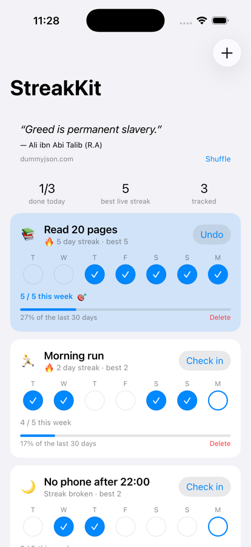
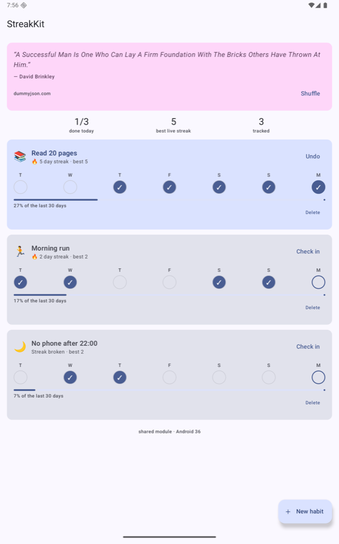

# StreakKit

A habit tracker built as two native apps over one shared Kotlin Multiplatform module — **and** a
worked example of every significant Claude Code capability applied to a real cross-platform
codebase.

| | |
| --- | --- |
| Shared logic | Kotlin Multiplatform (`shared/`) — domain, persistence, networking, presentation |
| Android | Jetpack Compose + Material 3 |
| iOS | Native SwiftUI |
| Tests | 44 shared tests on **both** JVM and Kotlin/Native (88 executions), plus UI tests on each platform |

<p align="center">
  
  
</p>

Same streak numbers, same percentages, same week strip — because both screens render the same
`HabitSummary` computed once in `commonMain`.

## The app

Five things: list habits, add one with a weekly goal, check in or undo for any day in the last
week, see your streak and 30-day completion, and track progress against that goal. Plus one
keyless network call for a daily quote, so there is an offline branch worth testing.

It is small on purpose. It exists to give the tooling something real to act on.

## Quick start

```bash
printf 'sdk.dir=%s/Library/Android/sdk\n' "$HOME" > local.properties

./gradlew :shared:allTests            # both targets — the gate that matters
./gradlew :androidApp:assembleDebug   # Android
cd iosApp && xcodebuild -project StreakKit.xcodeproj -scheme StreakKit \
  -destination 'platform=iOS Simulator,name=iPhone 17 Pro' build
```

Requires JDK 21, Android SDK 37, and Xcode. Optional: `ktlint`, `swiftformat`, `xcodegen` — every
hook and script degrades gracefully without them.

## The Claude Code part

Run `claude` in the repo root. **Accept the trust prompt on first launch** — until the folder is
trusted, Claude Code loads none of this repository's commands, skills or hooks, and ignores its
`permissions.allow` rules. In a headless `claude -p` run there is no prompt to accept, so a
`/kmp:test` there silently does nothing; trust the folder interactively once first.

Then try:

```
/kmp:test                 # run the shared suite; failures explained by target
/kmp:parity-check         # live cross-platform drift audit via the local MCP server
/ios:run                  # build, launch, screenshot, and actually look at it
/kmp:new-feature add a weekly goal to each habit
```

What is wired up, and where:

| Capability | Where |
| --- | --- |
| **Project memory** | `CLAUDE.md` at the root and in each module, so rules load by scope |
| **Slash commands** | `.claude/commands/` — namespaced, with pre-executed shell, file refs, tool allow-lists |
| **Skills** | `.claude/skills/` — path-scoped, progressive disclosure, a bundled generator script |
| **Subagents** | `.claude/agents/` — parity auditor, test writer, UI reviewer; each tool-restricted |
| **Hooks** | `.claude/hooks/` — 9 events: session start, two Bash guards, secret scanning, format-on-edit, subagent logging, pre-compact handoff, stop summary, notifications |
| **Notifications** | macOS banner + OSC 777 terminal sequence |
| **MCP (local)** | `.claude/mcp/streakkit_mcp.py` — stdlib Python; tools, resources *and* prompts |
| **MCP (external)** | `.mcp.json` — GitHub, filesystem, Context7; catalogued but opt-in |
| **Permissions / safety** | allow·ask·deny rules, programmatic guards, the full mode ladder |
| **Context engineering** | Scoped loading, `PreCompact` handoff, `/dev:checkpoint`, subagent delegation |
| **Automation** | Headless `claude -p` review, a pre-push hook, 5 GitHub Actions workflows |
| **Status line** | Branch, dirty count, and whether a simulator/emulator is actually attached |

The parity audit is the piece that ties it together. The local MCP server reports, live:

```
| Declaration             | commonMain | androidMain | iosMain | OK |
| `platformKeyValueStore` | fun @ …    | fun @ …     | fun @ … | ✅ |
| Field                   | Compose    | SwiftUI     | Parity  |
| `completionRate30d`     | ✅          | ✅           | ✅       |

Verdict: No drift detected.
```

The same code gates CI.

## Documentation

| | |
| --- | --- |
| [`docs/00-plan.md`](docs/00-plan.md) | The build plan this repo was made from |
| [`docs/01-architecture.md`](docs/01-architecture.md) | Why presentation is shared, not just domain |
| [`docs/02-claude-code-feature-map.md`](docs/02-claude-code-feature-map.md) | **Every feature, where it lives, how to try it** |
| [`docs/03-development-workflow.md`](docs/03-development-workflow.md) | How a change gets made |
| [`docs/04-post-delivery-operations.md`](docs/04-post-delivery-operations.md) | CI, review, triage, releases, incidents |
| [`docs/06-permissions-and-safety.md`](docs/06-permissions-and-safety.md) | The four safety layers and the danger flags |
| [`docs/07-context-engineering.md`](docs/07-context-engineering.md) | Surviving Gradle output and compaction |
| [`.claude/mcp/README.md`](.claude/mcp/README.md) | The MCP servers in detail |

## The one architectural rule

**Business logic lives in `shared/src/commonMain` and nowhere else.** Streaks, percentages,
labels and dates are computed once in `HabitsUiState.summarize()`; both apps render the result.
A number formatted inside a composable or a SwiftUI view is a parity bug even when it currently
produces the right answer — because there is now a second place for it to be wrong.

Almost everything else in this repository, including most of the Claude Code configuration, is
machinery for enforcing that rule.

## Status

Built and verified on macOS 15 with JDK 21.0.11, Gradle 9.8.2, Kotlin 2.4.21, AGP 9.4.1,
Xcode 26.6. Shared tests green on both targets; both apps build, install, launch and render
identically. The GitHub Actions workflows are live; the Claude-powered ones accept either a
`CLAUDE_CODE_OAUTH_TOKEN` or an `ANTHROPIC_API_KEY` repository secret — see
[`docs/04-post-delivery-operations.md`](docs/04-post-delivery-operations.md).
